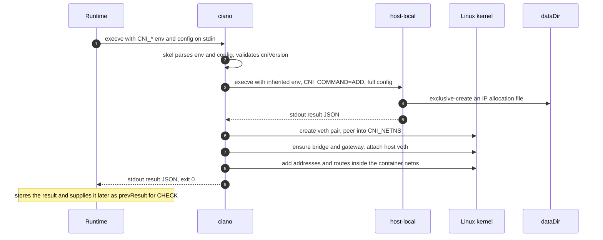

# ciano

A small, readable **Linux bridge CNI plugin** written in Go, built as a learning
project.

`ciano` delegates IP allocation to `host-local`, creates a veth pair, attaches the
host end to a Linux bridge, and configures the container's address and routes. It
implements the three lifecycle commands of the CNI protocol: `ADD`, `DEL`, and
`CHECK`.

> **Status:** educational project. `ADD`/`DEL`/`CHECK` are implemented and
> integration-tested with rootless user namespaces on Linux. Kubernetes/kind
> deployment is planned but not yet verified. Do not use this in production.

## Contents

- [How a CNI plugin works](#how-a-cni-plugin-works)
- [The network it builds](#the-network-it-builds)
- [Quick start](#quick-start)
- [Configuration](#configuration)
- [Development and testing](#development-and-testing)
- [Kubernetes with kind (planned)](#kubernetes-with-kind-planned)
- [Known limitations](#known-limitations)
- [Repository layout](#repository-layout)
- [References](#references)

## How a CNI plugin works

A CNI plugin is **a short-lived executable, not a daemon**. The container runtime
(kubelet → containerd/CRI-O, or the `cnitool` test harness) decides when networking
must be configured, then runs the plugin as a child process.

The entire interface between runtime and plugin is:

| Direction | Content |
|-----------|---------|
| **environment** | `CNI_COMMAND`, `CNI_CONTAINERID`, `CNI_NETNS`, `CNI_IFNAME`, `CNI_ARGS`, `CNI_PATH` |
| **stdin** | the network configuration JSON (including `type`, `ipam`, `prevResult` on `CHECK`) |
| **stdout** | on success: the result JSON; on failure: an error JSON object |
| **stderr** | logs only; the runtime ignores it |
| **exit code** | `0` success, non-zero failure |

The runtime finds the plugin by taking the config's `"type"` field and searching the
directories listed in `CNI_PATH`. It finds the config itself under `NETCONFPATH`
(`/etc/cni/net.d` by default) by the config's `"name"`.

### Protocol flow

```text
runtime (containerd, kubelet via CRI, or cnitool)
  │
  │ 1. read /etc/cni/net.d/10-ciano.conf
  │ 2. find binary "ciano" (from "type") in CNI_PATH
  │ 3. execve with:
  │      env   CNI_COMMAND=ADD
  │            CNI_CONTAINERID=<id>
  │            CNI_NETNS=/var/run/netns/<ns>
  │            CNI_IFNAME=eth0
  │            CNI_ARGS=...
  │            CNI_PATH=<colon-separated dirs>
  │      stdin the full network config JSON
  ▼
ciano
  │ skel.PluginMainFuncs: read env → read stdin → validate cniVersion
  │                        → dispatch cmdAdd
  │
  │ 4. ipam.ExecAdd("host-local", stdin)
  │      └─ execve host-local
  │           env inherited, CNI_COMMAND forced to ADD
  │           stdin: the same full network config
  │             ├─ reserve <dataDir>/<network>/<IP>  (exclusive file create)
  │             └─ stdout: result JSON (address, gateway, routes)
  │
  │ 5. open CNI_NETNS
  │    create veth pair (container end inside the netns, host end in the host ns)
  │    ensure cni0, attach the host end, assign the gateway address
  │    add the allocated address and routes inside the container
  │
  ▼
stdout: result JSON      runtime stores it
stderr: log lines        (the stored result is later supplied as prevResult for CHECK)
exit:   0, or non-zero with an error JSON on stdout
```

### What `skel` does

`github.com/containernetworking/cni/pkg/skel` implements the boring, error-prone
part of the protocol. The plugin supplies a table of callbacks; `skel` does the
rest. Simplified:

```go
skel.PluginMainFuncs(skel.CNIFuncs{
    Add:   cmdAdd,
    Del:   cmdDel,
    Check: cmdCheck,
}, version.All, "ciano v0.1.0")

// simplified internals:
command := os.Getenv("CNI_COMMAND")        // ADD | DEL | CHECK
data, _ := io.ReadAll(os.Stdin)            // network config JSON
// check data's cniVersion against the supported version set
args := &skel.CmdArgs{
    ContainerID: os.Getenv("CNI_CONTAINERID"),
    Netns:       os.Getenv("CNI_NETNS"),
    IfName:      os.Getenv("CNI_IFNAME"),
    Path:        os.Getenv("CNI_PATH"),
    StdinData:   data,
}
switch command {
case "ADD":   return cmdAdd(args)
case "DEL":   return cmdDel(args)
case "CHECK": return cmdCheck(args)
}
```

On a non-nil error, `skel` prints an error JSON object to stdout and exits
non-zero. For example, a missing IPAM plugin produces:

```json
{
    "code": 999,
    "msg": "failed to delegate IPAM to \"host-local\": failed to find plugin \"host-local\" in path [/nonexistent]"
}
```

Protocol-level failures use the CNI-defined error codes (e.g. code `6` = failed to
decode content); errors returned by the plugin's commands use code `999`.

### ADD sequence



### The delegation recursion

IPAM delegation uses **the same protocol again**: `ipam.ExecAdd` looks up
`host-local` in `CNI_PATH`, executes it with the inherited environment (overriding
only `CNI_COMMAND=ADD`), and writes the *whole* network config to its stdin. For
that invocation, `ciano` is the runtime and `host-local` is the plugin. `host-local`
reads the nested `"ipam"` object, allocates an address, records it on disk, and
prints its result JSON, which `ciano` reads and re-prints.

`DEL` and `CHECK` delegate the same way (`ipam.ExecDel`, `ipam.ExecCheck`).

## The network it builds

```text
 container network namespace                 host network namespace
┌─────────────────────────────┐          ┌───────────────────────────────────┐
│ eth0   10.22.0.2/16         │          │ cni0   10.22.0.1/16               │
│ default via 10.22.0.1       │          │  └── veth<hash>  (master = cni0)  │
└──────────────┬──────────────┘          └──────────────────┬────────────────┘
               │                                            │
               └──────────────── veth pair ─────────────────┘
```

`ADD` performs these steps:

1. Parse the config; treat `isDefaultGateway` as implying `isGateway`.
2. Delegate IP allocation to `host-local`.
3. Open the container's network namespace.
4. Derive the gateway(s), assign them to bridge `cni0`, and enable forwarding.
5. Create the veth pair: `eth0` inside the container, `veth<hash>` on the host.
6. Add the allocated address(es) and routes inside the container.
7. Attach the host end to `cni0` and bring it up.
8. Return a result describing every interface and address, which the runtime stores.

`DEL` reverses this: it deletes the veth (either end destroys the pair) and
releases the IP allocation. The bridge and its gateway address are shared
infrastructure and are intentionally left in place.

`CHECK` verifies that the interface, addresses, routes, bridge attachment, and
gateway still match the result returned by `ADD` (which the runtime supplies as
`prevResult`). It reports drift but never repairs it.

## Quick start

Requirements: Linux, Go 1.27+, and root (or `CAP_NET_ADMIN`/`CAP_SYS_ADMIN`) for the
real networking operations.

### 1. Get the helper plugins and `cnitool`

`ciano` needs `host-local`, and `cnitool` is a convenient runtime stand-in:

```bash
mkdir -p bin
curl -sSL -o bin/cni-plugins.tgz \
  https://github.com/containernetworking/plugins/releases/download/v1.9.1/cni-plugins-linux-amd64-v1.9.1.tgz
tar -xzf bin/cni-plugins.tgz -C bin
rm bin/cni-plugins.tgz
GOBIN=$PWD/bin go install github.com/containernetworking/cni/cnitool@v1.3.1
```

### 2. Build

```bash
make build
```

### 3. Test without root (recommended for development)

The integration harness runs the real plugin and host-local inside an unprivileged
user namespace. It needs no root, Docker, or changes to the host network:

```bash
make test-userns
# or run specific scenarios:
./hack/test-userns.sh add-del
./hack/test-userns.sh del-edge
./hack/test-userns.sh check
```

The harness redirects host-local's `dataDir` to a temporary directory and creates
its network namespaces with `unshare -Urn`. If unprivileged user namespaces are
restricted on your system, use the privileged container or a root shell instead.

### 4. Manual run with `cnitool` (root)

```bash
sudo ip netns add demo
sudo NETCONFPATH=$PWD/conf CNI_PATH=$PWD/bin ./bin/cnitool add ciano /var/run/netns/demo
sudo ip -n demo addr
sudo ip -n demo route

sudo NETCONFPATH=$PWD/conf CNI_PATH=$PWD/bin ./bin/cnitool check ciano /var/run/netns/demo
sudo NETCONFPATH=$PWD/conf CNI_PATH=$PWD/bin ./bin/cnitool del ciano /var/run/netns/demo

sudo ip netns del demo
```

`cnitool` v1.3.1 caches ADD results under `/var/lib/cni`, so it must run as root.
Using `NETCONFPATH` and `CNI_PATH` keeps the configuration and binaries inside the
repository; only the kernel state and the cnitool cache are outside it.

If you prefer an isolated environment, run everything in a privileged container:

```bash
docker run --rm -it --privileged -v "$PWD:/work" -w /work ubuntu:24.04
# inside:
apt-get update && apt-get install -y iproute2 iputils-ping iptables
```

## Configuration

The sample config is [`conf/10-ciano.conf`](conf/10-ciano.conf):

```json
{
  "cniVersion": "1.0.0",
  "name": "ciano",
  "type": "ciano",
  "bridge": "cni0",
  "isGateway": true,
  "isDefaultGateway": true,
  "ipam": {
    "type": "host-local",
    "subnet": "10.22.0.0/16",
    "routes": [{ "dst": "0.0.0.0/0" }]
  }
}
```

| Field | Default | Behavior |
|-------|---------|----------|
| `cniVersion` | required | Supported versions are those in `version.All` (0.1.0 through 1.1.0); results are printed in this version. |
| `name` | required | Network identity; also the directory name used by host-local. |
| `type` | required | Binary name the runtime looks up in `CNI_PATH`. |
| `bridge` | `cni0` | Bridge name. Created if missing; must already be a bridge if present. |
| `isGateway` | `false` | Assign IPAM gateways to the bridge and enable forwarding. |
| `isDefaultGateway` | `false` | Implies `isGateway`; adds a default route if IPAM did not provide one. |
| `ipMasq` | `false` | Parsed, but **not implemented** yet; a warning is printed and no NAT rules are created. |
| `mtu` | `0` (kernel default) | Applied when creating the veth pair and bridge. The MTU of an existing bridge is not changed. |
| `hairpinMode` | `false` | Sets hairpin mode on the host veth. |
| `ipam` | required | Delegated to the plugin named by `ipam.type`. |
| `ipam.type` | required | `host-local` in the sample. |
| `ipam.subnet`, `ipam.routes`, `ipam.dataDir` | host-local defaults | Passed through unchanged to host-local. |

The full, normative description is in [`SPEC.md`](SPEC.md).

## Development and testing

```bash
make fmt        # gofmt -w
make vet        # go vet
make test       # unit tests
make build      # bin/ciano
make test-userns
```

Unit tests cover configuration parsing/defaults, veth naming, gateway derivation,
and the result-preparation rules (gateway, default route, interface index). The
integration harness covers:

- `add-del`: two containers, gateway and pod-to-pod ICMP, cleanup.
- `del-edge`: double DEL, netns destroyed before DEL, host veth removed by hand,
  empty `CNI_NETNS`, and DEL for a container that was never added.
- `check`: positive CHECK, missing `prevResult`, interface down, address removed,
  host veth detached, wrong netns, and two live containers.

## Kubernetes with kind (planned)

> This section is the intended setup and has **not been verified yet**. Phase 7 of
> the project is to run it end to end.

kind nodes are containers, so the plugin and config must be mounted into the node
rather than copied to the host's `/opt/cni/bin`:

```yaml
kind: Cluster
apiVersion: kind.x-k8s.io/v1alpha4
networking:
  disableDefaultCNI: true
  podSubnet: "10.22.0.0/16"
nodes:
  - role: control-plane
    extraMounts:
      - hostPath: /path/to/ciano/bin
        containerPath: /opt/cni/bin
      - hostPath: /path/to/ciano/conf/10-ciano.conf
        containerPath: /etc/cni/net.d/10-ciano.conf
```

Replace `/path/to/ciano` with the absolute path of this repository. Mounting `bin/`
over `/opt/cni/bin` provides `ciano`, `host-local`, and the other reference plugins
inside the node. `disableDefaultCNI: true` removes kindnet so only this plugin
configures pod networking.

Expected scope for the first cluster test: **single node**, pod-to-pod connectivity.
Multi-node pod networking additionally requires a distinct host-local subnet per
node and routes for the other nodes' pod subnets; that is documented as future
work. Pod egress beyond the node also needs `ipMasq`, which is not implemented yet.

## Known limitations

- `ipMasq` is parsed but not implemented (no NAT rules).
- kind/Kubernetes deployment is not verified yet; the design is single-node.
- The code is family-aware, but only IPv4 has been exercised.
- No VLAN, promiscuous-mode, port-isolation, MAC-spoof-check, or
  disable-container-interface options.
- No `GC` or `STATUS` commands.
- The MTU of a pre-existing bridge is not reconciled with `mtu` in the config.
- The bridge, its gateway address, host-local's cursor/lock files, and the bridge
  persist after the last container is deleted.
- Not hardened for production; no CI, no fuzzing, no upgrade path.

## Repository layout

```text
.
├── main.go                  # skel wiring + ADD/DEL/CHECK orchestration
├── bridge.go                # netlink operations + state validation
├── netconf.go               # configuration struct and loader
├── bridge_test.go           # network helper unit tests
├── netconf_test.go          # config parsing unit tests
├── conf/10-ciano.conf       # sample network configuration
├── hack/test-userns.sh      # rootless integration harness
├── kind/                    # kind cluster config (planned)
├── Makefile
├── bin/                     # built binaries and downloaded CNI plugins (gitignored)
├── SPEC.md                  # normative specification
└── README.md
```

## References

- CNI specification: <https://github.com/containernetworking/cni/blob/main/SPEC.md>
- CNI plugins (reference `bridge` plugin and `host-local`):
  <https://github.com/containernetworking/plugins>
- `vishvananda/netlink`: <https://github.com/vishvananda/netlink>
